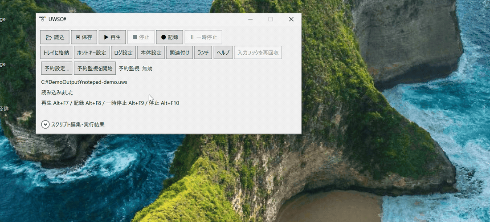
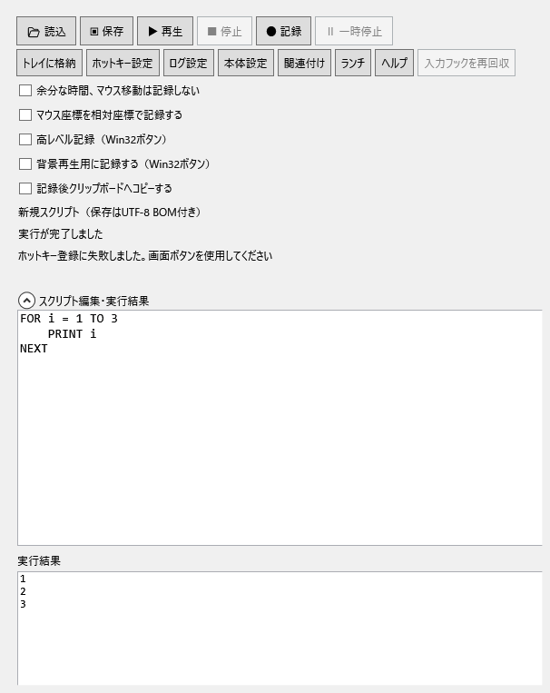
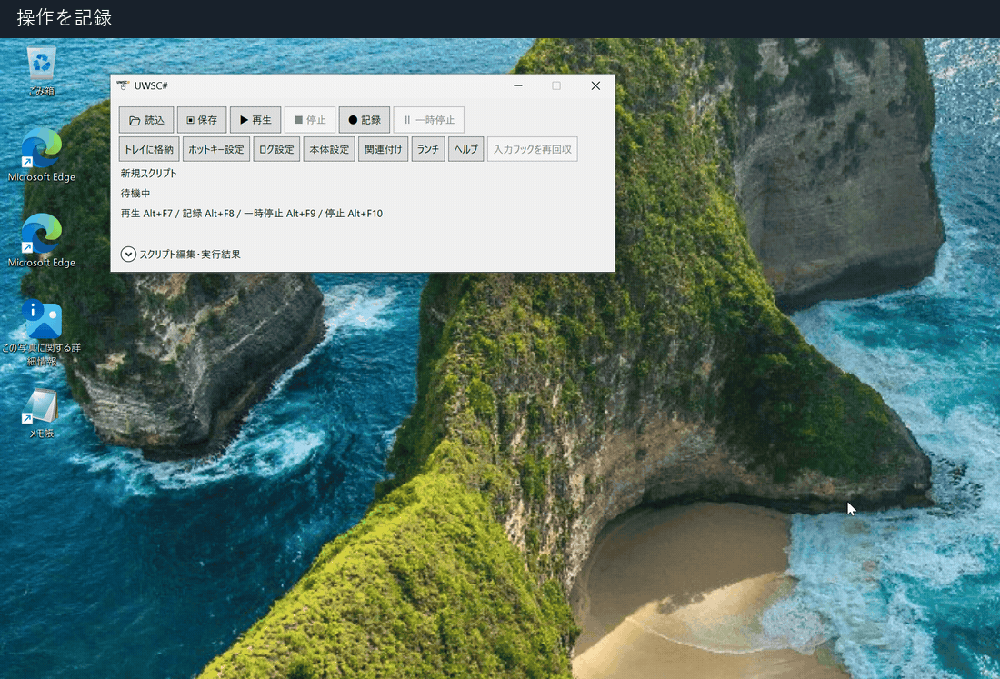

# UWSC#

UWSC# は、Windows 11 x64 でマウスやキーボードの操作を記録し、スクリプトとして再生できる自動化ツールです。WPF 版では、記録した操作を編集したり、自分で書いた `.uws` ファイルを読み込んで実行したりできます。コマンドライン版と、スクリプト作成を支援するローカル MCP サーバーもあります。

## 動作デモ

Windows Sandbox 内で **「▶ 再生」** を押すと、スクリプトがメモ帳を開き、タイトルバーをドラッグしてウィンドウを移動し、`Hello from UWSC#!` を入力します。



## 最初のスクリプトを実行する

1. [GitHub Releases](https://github.com/Kawayan/uwscsharp-public/releases) から Windows x64 向けの ZIP をダウンロードし、書き込み可能なフォルダーにすべて展開します。
2. `UWSCSharp.Wpf.exe` を起動し、画面下部の **「スクリプト編集・実行結果」** を開きます。
3. 上側の編集欄に次のスクリプトを貼り付け、画面上部の **「▶ 再生」** をクリックします。

```text
FOR i = 1 TO 3
    PRINT i
NEXT
```

「実行が完了しました」と表示され、下側の「実行結果」に `1`、`2`、`3` が1行ずつ並びます。



画面例の「ホットキー登録に失敗しました」は、撮影環境でショートカットキーを登録できなかったことを示します。この場合も画面のボタンで操作できます。

## マウスやキーボードの操作を記録する

新規スクリプトで **「● 記録」** をクリックし、繰り返したい操作を行います。**「■ 記録終了」** をクリックすると、編集欄に操作内容がスクリプトとして表示されます。対象を操作開始前の状態に戻してから、**「▶ 再生」** で動作を確認できます。記録を残す場合は、**「▣ 保存」** で `.uws` ファイルに保存します。

下のGIFでは、Windows Sandbox 内でメモ帳を開き、タイトルバーをドラッグして `Hello UWSC#` と入力する操作を記録します。記録を終了し、メモ帳を元の位置に戻して閉じてから **「▶ 再生」** を押すと、同じ操作が繰り返されます。



記録設定や対応する操作は[操作記録のヘルプ](https://kawayan.github.io/uwscsharp-public/pages/recording.html)、構文や関数は[利用者向けヘルプ](https://kawayan.github.io/uwscsharp-public/)を参照してください。オフラインではブラウザーで [docs/user-help/index.html](docs/user-help/index.html) を開けます。

## ビルド

Windows 11 x64、.NET 11 SDK（`global.json` 参照）、PowerShell 7を使います。

Windowsテストのネイティブフィクスチャのビルドには、Visual StudioのC++デスクトップ開発ワークロードとWindows SDKが必要です。

```powershell
dotnet build UWSCSharp.slnx -c Release
pwsh -NoProfile -File scripts/test-headless.ps1 -Configuration Release
```

テストスクリプトは、GUI操作を伴わない重要な回帰テストを実行します。テスト結果は `artifacts/test-runs/` に保存します。  
実画面・入力・フォーカスを使うテストはWindows Sandboxなどの専用ゲストで実行してください。

ヘルプを更新する場合は、[生成と確認の手順](docs/user-help/README.md)を参照してください。

### 記録・再生GIFを撮り直す

Windows 11 x64 で、Windows Sandbox CLI（`wsb`）、.NET 11 SDK、PowerShell 7、FFmpeg を用意します。FFmpeg は単体で実行でき、`gdigrab`、`libx264`、`drawtext` に対応したビルドを使います。既存の Windows Sandbox を閉じてから、リポジトリのルートで実行します。[Windows Sandbox CLI のドキュメント](https://learn.microsoft.com/en-us/windows/security/application-security/application-isolation/windows-sandbox/windows-sandbox-cli)

```powershell
pwsh -NoProfile -File scripts/capture-readme-recording.ps1
```

UWSC# のビルドから、Windows Sandbox 内での記録・再生と撮影、字幕付きGIFへの変換まで自動で実行します。記録時と再生時でメモ帳の移動先と入力文字列が一致すると、`docs/images/notepad-record-replay.gif` を更新します。別のファイルへ保存するには `-OutputPath` を指定してください。元動画・生成スクリプト・ログは `artifacts/readme-recording/` に残ります。

撮影にはクラシック版のメモ帳を使います。既定の `%SystemRoot%\System32\notepad.exe` で起動できない環境では、`-NotepadPath` でクラシック版の実行ファイルを指定します。

## 不具合の報告

不具合を見つけた場合は以下から報告いただけると助かります。  
[<kbd>不具合を報告</kbd>](https://github.com/Kawayan/uwscsharp-public/issues/new?template=bug-report.yml)


## 支援
UWSC# を気に入ってもらえたら、GitHub Sponsors で応援していただけると開発の励みになります！  
[<kbd>GitHub Sponsors で支援</kbd>](https://github.com/sponsors/Kawayan)

## WiX バンドル EXE の作成

Windows x64 向けのセットアップ EXE を作成できます。WiX Burn がアプリの MSI を EXE に内蔵します。.NET 11 SDK、PowerShell 7、Visual Studio の C++ デスクトップ開発ワークロードと Windows SDK を用意してください。WiX 7 はビルド時に NuGet から復元します。[WiX 7 の利用条件](https://docs.firegiant.com/wix/osmf/)を確認し、同意する場合は次のコマンドを実行してください。

```powershell
pwsh -NoProfile -File scripts/build-wpf-bundle.ps1 -Version 0.1.0-preview.1 -InstallerVersion 0.1.0 -OutputDirectory artifacts/wpf-bundle -AcceptWixEula
```

変更をコミットしてから、まだ存在しない出力先を指定してください。`-Version` はアプリの版、`-InstallerVersion` はセットアップ EXE と内蔵 MSI が更新の判定に使う数値版です。セットアップを更新する場合は数値版も上げてください。`bundle` フォルダーにセットアップ EXE と SHA-256 ファイルを出力します。

セットアップ EXE は現在のユーザーの `%LOCALAPPDATA%\Programs\UWSCSharp` にアプリをインストールし、スタートメニューにショートカットを追加します。`.uws` の関連付け候補の登録は任意です。32ビット DLL を呼び出す場合の x86 版 .NET は別途導入してください。

## ライセンス

[MIT License](LICENSE)
